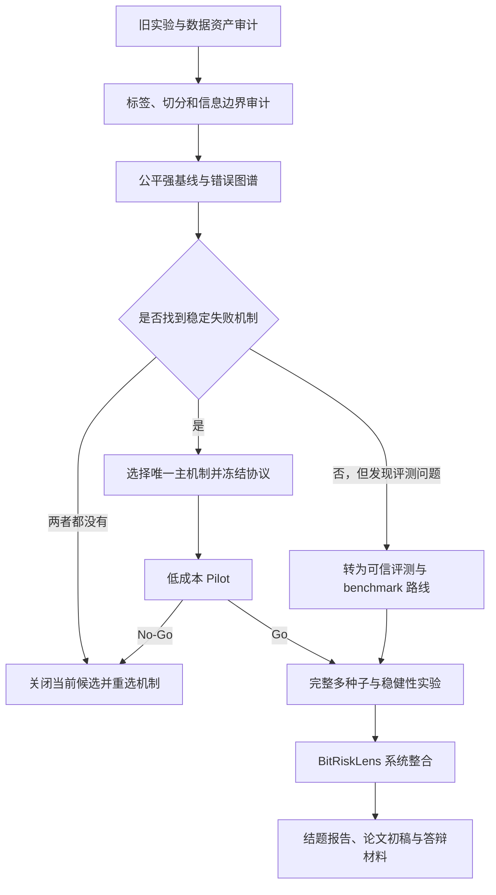

# 比特币实体分类可靠性与性能改进：后续计划

日期：2026-09-07

适用分支：`experiment-campaign`（继承自大创分支 `innovation-project`）

当前状态：研究策略已确认；具体创新机制尚未冻结；现有实验先作为待复核证据，不直接作为最终结论。

## 1. 计划要解决的核心问题

本项目后续不再在“做一个很新的方向”和“单纯提高 F1”之间二选一，而是把两者连成一条可验证的路线：

> 先找出现有 11 类比特币实体分类真正的失败原因，再针对证据最强的一个原因提出改进，并在公平、可复现、符合信息时间边界的协议下检验它是否同时提高分类性能与结果可信度。

这意味着项目仍然要争取更高的 Macro-F1 和少数类 F1，但不会把“分数更高”本身当作创新。最终必须回答三个问题：

1. 现有模型为什么会分错，哪些错误是模型能力不足，哪些错误来自数据、标签或评测协议？
2. 当前 EdgeGatedSAGE（EGS）的优势到底来自方向信息、边特征、参数量、训练预算，还是其他混杂因素？
3. 针对一个已经被实验确认的失败机制，能否提出一个简单、清楚、稳定的改进，并在未参与选择的测试数据上成立？

项目的监督目标保持为 `0–10` 的 11 类实体类型。`-1` 只表示未标注图上下文，不能当作正常类、负类或“未知非法类”。项目正文和系统不得把实体类型分类成绩描述成非法、欺诈或洗钱识别准确率。

## 2. 预期形成的完整成果

高质量大创不应只有一个模型分数。计划形成一套相互支撑的成果：

1. **可信数据与评测协议**：明确预测单位、标签语义、信息截止时间、切分、特征可得性和测试集使用纪律。
2. **强基线与可复现结果**：非图模型、普通图模型和现有 EGS 在完全相同条件下比较，所有数字能回到配置、数据版本、运行记录和原始预测。
3. **分类错误图谱**：说明哪些类别、时间段、节点规模和邻域结构最容易失败，并提供典型案例。
4. **一个经过证据筛选的核心改进**：只解决最重要、最稳定的失败机制，不堆叠多个未经验证的模块。
5. **可信输出能力**：除类别外，展示置信度、校准、拒判或错误风险，让系统能诚实表达“证据不足”。
6. **可现场演示的系统**：复用 BitRiskLens，展示实体图、模型对比、错误原因、信息截止和证据来源。
7. **结题材料包**：结题报告、论文初稿、答辩 PPT、演示脚本、使用说明、实验登记和可复现清单。

最终作品的建议内部名称为：

> **面向比特币实体类型识别的可靠图学习与可信评测系统**

正式立项题名是否调整由项目负责人和指导教师决定。技术材料中可以保留与原题目的连续性，但必须纠正“11 类实体类型等于非法类别”的错误表述。

## 3. 两条都能产生有效成果的路线

### 路线 A：模型与机制贡献

若诊断确认某个机制确实导致错误，例如方向信息丢失、时间外邻域失真或模型过度依赖邻居，则围绕该机制完成一个最小改进。成功标准不是单次最好分数，而是：

- 在参数量、训练轮数、调参预算和数据协议公平的条件下稳定优于最强基线；
- 改进集中发生在机制预测的样本或类别上，而不是无法解释的整体波动；
- 多随机种子方向一致；
- 校准、少数类表现或时间外推至少不明显恶化；
- 独立测试结果与开发阶段结论一致。

### 路线 B：数据与评测贡献

若模型优势在公平控制后明显缩小，或者发现现有协议使用了不应出现的信息，则转向建立可信评测基准。可成立的成果包括：

- 证明参数量或调参预算造成了虚假的模块贡献解释；
- 证明某种随机切分、最终实体聚类或未来特征改变了模型排名；
- 给出严格的信息截止协议、泄漏检测和可复现基线；
- 说明旧高分在哪些条件下成立、在哪些条件下不能外推。

路线 B 不要求分数更高，但必须发现**稳定、可重复、会改变结论的评测问题**。如果既没有可靠性能增益，也没有实质评测发现，就不能把普通复现包装成创新成果，应回到候选机制重新选择。

## 4. 当前证据怎样使用

现有资产很有价值，但需要重新界定证据强度。

| 已有结果或材料 | 可以暂时说明 | 目前不能说明 | 后续处理 |
|---|---|---|---|
| class-balanced 协议下 EGS 三种子优于 GraphSAGE | 图模型改进存在值得复核的性能信号 | 方向聚合和边门控分别贡献了多少；是否适用于未来时期 | 对原始运行、配置和预测做追溯；进行参数量匹配的组件消融 |
| “完整 EGS”明显优于“无方向 EGS” | 方向信息可能重要 | 差异一定由方向语义造成 | 加入同参数量宽 GraphSAGE、仅方向拆分模型和同预算调参 |
| temporal 协议分数较低 | 时间外数据更困难 | 下降一定由时间漂移或未来信息泄漏造成 | 在相同样本、特征和构图规则下逐项隔离变化来源 |
| `experiment-campaign` 的自特征残差快筛 | 邻域失真时保留自身特征可能有用 | 单种子、小轮次结果已经构成稳定创新 | 保留预注册和结果；等待匹配轮次、多种子与独立测试后再判断 |
| GBDT 在当前 temporal 子协议表现较低 | 当前实现下图结构可能提供额外信号 | 所有非图基线都无效，或图结构天然更可靠 | 核对特征、调参预算和数据接口，再与可用的强 tabular 基线比较 |
| 最终 252M 实体图和官方构图流水线 | 可复用为回顾性实体分类资产 | 能直接恢复任意历史时点的实体分区 | 历史实体图只作为候选诊断；先过小窗口无模型数据门 |

任何旧报告中的因果措辞，例如“方向聚合是核心贡献”“未标注邻居是噪声”“时间漂移导致崩溃”，在完成对应控制实验前都降级为待检验假设。

## 5. 候选失败机制与决定性实验

第一阶段不急着选新模型，而是比较下面五类机制。只有通过决定性实验的机制才允许进入方法开发。

| 编号 | 候选机制 | 要观察的证据 | 决定性低成本实验 | 通过后可能形成的创新 |
|---|---|---|---|---|
| M1 | 入边和出边语义不同，普通聚合混淆资金流方向 | 方向相反但其他统计相近的实体容易混淆；方向拆分在多类上有一致收益 | 普通 SAGE、同参数量宽 SAGE、仅方向拆分 SAGE、EGS 在同协议同预算下比较 | 简洁的方向条件消息传递，或方向机制的可靠实证结论 |
| M2 | 时间外邻域失真，模型过度依赖邻居 | 较晚时期邻域分布变化与错误增加相关；自身特征仍有区分力 | EGS 与加入最小 self residual 的模型做匹配轮次、多种子比较，并按时间片和类别分析 | 邻域可靠性感知或自身信息退路机制 |
| M3 | 类别长尾、来源差异或标签冲突主导错误 | 弱类错误与样本量、来源、标签冲突显著相关 | 强 tabular/MLP 基线、类权重和阈值/校准对照；不先增加复杂损失 | 来源稳健训练、可信拒判或标签质量协议 |
| M4 | 最终实体聚类把未来关系回填到历史图 | 相同地址集合在 as-of 与最终分区下出现稳定跨时合并、边重写或标签冲突 | 小窗口按区块记录 union；在同一地址交集、固定标签投影和两种 CoinJoin 过滤下做无模型比较 | 严格按时可见构图与实体级评测协议 |
| M5 | 现有高分主要来自切分、容量或调参混杂 | 更严格控制后模型排名改变或增益消失 | 统一数据、切分、参数量、轮数和调参次数，逐项只改一个因素 | 公平 benchmark、泄漏/捷径诊断和可复现评测 |

这五类机制不是五个都要做成最终创新。诊断阶段可以同时比较；方法阶段只保留证据最强的一项，其余作为消融、限制或后续工作。

## 6. 分阶段执行计划

### 阶段 0：证据和运行资产闭环

**目标**：先确认仓库里已经存在的分数是否能完整追溯，避免在不可靠结论上继续开发。

主要任务：

1. 清点 `experiments/` 下每个关键运行的配置、模型参数、训练历史、预测文件和汇总表。
2. 将历史摘要数字逐项回连到原始结果；核对数据协议、模型版本、随机种子和最佳轮次。
3. 区分已完成、失败、中止、仅 smoke 和缺少产物的运行。
4. 检查 `experiment-campaign` 预注册、快筛、正式运行和测试集打开记录是否一致。
5. 为关键数据记录 schema、样本数、标签分布、文件哈希或数据库快照信息。
6. 保留当前工作树状态和代码 revision；不把 dirty 工作树只记录成一个 commit hash。

交付物：

- 当前结果可信度清单；
- 关键运行到原始产物的映射；
- 数据与协议 manifest；
- 无法复现或证据不完整的历史结论列表。

通过条件：所有进入后续决策的数字均能定位到数据协议、配置、seed 和原始预测。不能定位的结果只作线索，不进入最终报告主张。

### 阶段 1：任务、标签与切分审计

**目标**：固定“模型到底在预测什么”，并排除最明显的标签和切分问题。

主要任务：

1. 核对 11 类的样本数、来源、时间范围和已知标签冲突。
2. 检查同一实体、地址来源或高相似节点是否跨训练、验证、测试集合出现。
3. 明确 `-1` 节点只参与图上下文，不参与监督损失和负类统计。
4. 对 random/class-balanced、label-preserving 和 temporal 协议制作同口径差异表。
5. 将样本选择、图边、节点特征和时间范围逐项分开，避免把多个变化共同造成的分数差解释为单一“时间漂移”。
6. 确认所有标准化、类别权重、特征选择、阈值和校准只使用训练/验证数据拟合。

交付物：

- 标签与预测单位说明；
- 切分重叠和潜在泄漏报告；
- 三类协议的同口径差异矩阵；
- 最终可用于开发的训练集和验证集定义草案。

停止条件：若标签无法支撑实体类型主张，或训练测试之间存在无法消除的身份泄漏，则暂停模型优化，先修正数据或降低任务主张。

### 阶段 2：建立可信基线和错误图谱

**目标**：知道模型真正比什么强，以及错误集中在哪里。

基线顺序：

1. 多数类和简单规则，检查任务下限与数据异常；
2. 复用仓库已有的 tabular/GBDT 路线；
3. MLP，测量只看节点特征能做到什么；
4. GraphSAGE，测量无复杂机制的图结构收益；
5. 同参数量宽 GraphSAGE，控制“模型更大”这一混杂；
6. 仅方向拆分的 Dir-SAGE，隔离方向语义；
7. 现有 EGS，测量方向、边特征与门控的组合收益；
8. 当前 self residual 候选，只作为时间邻域失真假设的检验。

所有基线使用同一数据、同一切分、相同可用特征、相同早停规则和可比调参预算。模型参数量、训练时间和峰值内存同时记录。

错误图谱至少包括：

- 每类 precision、recall、F1 和混淆对；
- Macro-F1、少数类 Macro-F1、balanced accuracy；
- 按时间片、节点度数、交易活跃度、实体规模和标签来源分层；
- 置信度校准、Brier score、ECE 和 risk–coverage 曲线；
- 高置信错误、低置信正确、少数类漏检和跨时期失效案例；
- 图同配/异配、入出边不平衡与错误之间的关系。

交付物：

- 公平基线表；
- 参数量与训练预算表；
- 分类错误图谱；
- 候选机制证据矩阵。

### 阶段 3：选择唯一主机制并冻结协议

**目标**：用证据选择创新，不凭直觉继续堆模块。

每个候选机制按以下条件评分：

1. 是否影响足够多的样本或关键类别；
2. 是否能被一个只改变单一因素的实验重复观察；
3. 是否已有直接同类工作完成了相同问题；
4. 是否能形成清楚、可证伪的研究假设；
5. 是否能导出可展示、可解释的系统行为；
6. 如果改进失败，是否仍能得到诚实而有用的结论。

选定后形成 Gate 3A 协议，冻结：

- 研究问题和主假设；
- 数据版本、节点/边定义和信息截止；
- 训练、验证和最终测试切分；
- 主要、次要和安全性指标；
- 强基线、候选方法和消融；
- 相同的调参预算、种子、停止规则；
- 统计独立单位、置信区间方法；
- test 打开次数和每次打开的条件；
- Go/No-Go 阈值及失败后的转向路线。

在冻结具体机制前补做一次组件级最近邻核验。文献检索继续保留两条独立链：Undermind 用于深检、语义扩展和引用链；主负责人另用论文原文、官方代码/数据入口及文献检索工具主动寻找反证。两条链分别记录查询并按 DOI/标题去重，关键结论回到全文、表格或官方实现。经过核验的核心文献继续存入独立 Zotero 集合“**大创2026｜创新方向调研**”，同时更新本仓库的主张—证据记录。

**暂定方法晋级线**：开发集上相对最强容量匹配基线的平均 Macro-F1 提升至少 `+0.015`，至少 3 个种子方向一致，同时少数类、校准和时间切片没有不可接受的系统退化。该数值只是计划阈值，须在查看最终测试前结合基线方差和最小有意义效应正式冻结；冻结后不得根据测试结果修改。

若模型增益未达到阈值，但协议修正稳定改变模型排名、错误分布或结论，则可以转路线 B。若两条路线均无实质结果，回到本阶段选择下一候选，不继续在失败模型上反复调参。

### 阶段 4：低成本 Pilot

**目标**：在不动用 252M 全图和大规模调参前，判断核心假设是否值得继续。

主要规则：

1. 只使用开发数据，不读取最终测试结果。
2. 每个模型获得相同数量的配置尝试；不因某模型熟悉而额外调参。
3. 使用固定的 3 个种子进行方向判断；若波动大，先查实现和数据，不扩大结论。
4. 每次只改变一个核心因素，保留预测文件用于配对错误分析。
5. 对 as-of 实体图候选先做无模型数据门：固定地址交集和标签投影，比较分区、边和冲突；只有影响稳定才训练模型。
6. 失败、运行中止和无增益结果全部进入实验登记。

Pilot 输出三选一：

- **Go**：机制证据和预设阈值均满足，进入完整实验；
- **No-Go**：机制没有稳定作用，关闭该方向；
- **回到阶段 3**：出现新的、能明确验证的机制证据，重新冻结协议版本。

### 阶段 5：完整实验与稳健性验证

**目标**：证明结果不是偶然种子、单一切分或单个类别造成的。

计划包含：

1. 至少 5 个固定随机种子；使用配对比较，报告均值、离散程度和效应量。
2. 三种评价环境：标准回顾性协议、严格时间外协议、经审计的实体/来源隔离协议。它们是不同评价环境，不虚称为三个独立数据集。
3. 强基线、容量匹配、等调参预算和关键组件消融。
4. 时间片、标签来源、节点规模、类别支持度和图结构变化的敏感性分析。
5. 校准、拒判与覆盖率分析；系统允许在证据不足时不强行分类。
6. 训练和推理效率、内存占用及模型参数量比较。
7. 典型成功案例和失败案例，说明方法的适用边界。
8. 若有足够独立单位，使用按时间块或实体组的重采样置信区间；不能只用 seed 标准差代替数据不确定性。

最终测试集仅按冻结协议打开。`experiment-campaign` 已有预注册所产生的测试结果只属于该协议，不能继续用于新方法选择；如新研究问题变化，必须建立新的独立测试或明确把旧测试降级为开发证据。

### 阶段 6：系统整合与答辩交付

**目标**：把研究证据变成评委可以理解、现场可以验证的完整作品。

系统优先复用 `apps/bitrisklens/`，只增加最终研究结论确实需要的页面，不提前重写框架。建议展示四条主线：

1. **实体分类**：输入实体或演示样本，输出实体类型、置信度和拒判状态；
2. **模型对比**：同一实体在 MLP、GraphSAGE、EGS 和最终方法下的结果；
3. **错误解释**：展示主要混淆类别、入出边特征、时间位置和邻域变化；
4. **证据边界**：明确数据截止、标签来源、模型不知道什么，以及为什么该结果不能直接等同风险定罪。

答辩材料至少形成：

- 一张项目问题与技术路线图；
- 一张公平实验协议图；
- 一张分类错误图谱；
- 一张主结果表、一张消融表、一张可信度/稳健性表；
- 三个可重复演示案例；
- 一个失败案例，主动说明模型边界；
- 结题报告、论文初稿、PPT、演示视频或现场备用录屏；
- 从结论到数据、代码、运行记录的可追溯清单。

## 7. 整体依赖关系

## 8. 六周时间安排

答辩准确日期尚未核实，以下以 2026 年 9 月 7 日为起点安排；若学院通知更早，优先保留协议、主实验和演示三项，压缩非关键扩展。

| 时间 | 重点工作 | 必须完成的里程碑 |
|---|---|---|
| 第 1 周（9 月 7–13 日） | 阶段 0：旧结果、配置、预测和数据协议追溯 | 可信度清单；确认哪些历史数字可用；不再依据未追溯摘要做决策 |
| 第 2 周（9 月 14–20 日） | 阶段 1–2：标签/切分审计、公平基线、错误图谱 | 找出 1–2 个最有证据的失败机制；完成容量匹配实验设计 |
| 第 3 周（9 月 21–27 日） | 阶段 3：机制选择、最近邻补查、协议冻结 | 用户和指导教师可审阅的一页主问题说明；Gate 3A v1 冻结 |
| 第 4 周（9 月 28 日–10 月 4 日） | 阶段 4：低成本 Pilot；Go/No-Go | 只允许一个主方法晋级；失败则转可信评测路线 |
| 第 5 周（10 月 5–11 日） | 阶段 5：完整实验、消融、稳健性、校准 | 冻结主结果表、消融表、错误案例和结论边界 |
| 第 6 周（10 月 12–18 日） | 阶段 6：系统、报告、PPT、演示与答辩演练 | 完整结题包；离线演示备份；评委问题清单与回答证据 |

如果答辩晚于 10 月 18 日，额外时间用于重复关键实验、改进系统稳定性和完善文档，不用于无依据地继续堆模型。

## 9. 各阶段的硬性停止条件

出现下列任一情况，必须停止对应主张或降级路线：

1. 标签来源或语义不能支持“实体类型识别”结论；
2. 测试集泄漏、实体重叠或未来信息无法消除；
3. 模型收益只在单个种子、单个类别或单次调参中出现；
4. 容量匹配后收益消失，且没有形成有价值的评测发现；
5. 简单 tabular/MLP 基线与复杂模型相当，而复杂方法不能解释额外价值；
6. as-of 聚类差异对过滤规则极度敏感，方向会翻转；
7. 最近邻工作已完整覆盖同一问题、方法和实验，而本项目没有实质增量；
8. 为得到正结果需要反复查看测试集、改变阈值或删除失败种子；
9. 系统输出无法解释证据边界，容易把实体类别误写成非法风险。

负结果不删除。若它推翻了旧假设或避免了错误评测，可以进入结题报告；但“没有做出效果”本身不自动成为创新。

## 10. 风险与应对

| 风险 | 影响 | 应对 |
|---|---|---|
| 历史实验产物不完整 | 旧分数无法用于结论 | 降级为线索；在冻结协议下最小复跑，不批量补跑全部历史模型 |
| EGS 优势来自参数量或调参次数 | 原模型创新解释失效 | 加容量匹配和等预算基线；将结果转为机制澄清或 benchmark |
| 时间协议同时改变多个因素 | 无法归因性能下降 | 固定样本交集，逐项改变时间、构图、特征和标签来源 |
| as-of 实体图无法从现有数据库恢复 | 候选 M4 无法直接实验 | 先用小窗口原始链重放；数据门失败即关闭，不扩建全图流水线 |
| 新方法没有稳定提高 Macro-F1 | 模型路线不能晋级 | 检查是否存在稳定评测发现；没有则切换下一机制，不继续堆模块 |
| 少数类样本太少 | 单类结论波动大 | 报告支持度与置信区间，限制主张；拒绝只展示最好类别 |
| 答辩时间提前 | 完整扩展来不及 | 优先级固定为协议与主结果 > 稳定演示 > 扩展实验和外观优化 |
| 项目题名含“非法识别” | 容易产生不当主张 | 在报告开头解释标签边界，系统使用“实体类型/审查辅助”措辞 |

## 11. 质量验收标准

### 科学性

- 每个主要结论都有原始预测、配置、数据版本和运行记录；
- 至少一个强非图基线和两个图基线；
- 关键对照控制参数量、训练轮数和调参预算；
- 主要结果为多种子，且有适合数据结构的不确定性分析；
- 最终测试不参与方法选择；
- 同时报告负结果、失败类别和适用边界。

### 创新性

- 创新针对经过诊断确认的问题；
- 能用一句话说明“过去方法为什么不够、我们的新增证据或机制是什么”；
- 最近邻检索到组件级，而不只检查论文标题；
- 不把换模型、堆模块或单次 F1 增长当作完整创新；
- 理论性质只有在能解决真实问题并导出可检验推论时才写，不添加装饰性定理。

### 工程性

- 复用 `src/btcaml/`、现有运行脚本、配置和实验登记；
- 研究运行统一使用仓库 `uv` 环境；
- 演示系统能离线运行关键案例，失败时有明确提示；
- 不在演示数据中伪造真实主体指控或把代理分数说成真实风险概率。

### 答辩表达

- 五分钟内说明问题、旧方法缺陷、核心改进、证据和边界；
- 评委能看到模型为何改善，而不只看到一个 F1 数字；
- 能回答数据从哪里来、标签是什么意思、是否使用未来信息、为何基线公平；
- 现场演示和备用录屏均可用。

## 12. 下一步执行顺序

接下来按以下顺序行动，不先启动新的大规模训练：

1. 完成关键历史运行与原始预测的追溯清单；
2. 审计现有三个数据协议究竟同时改变了哪些因素；
3. 建立容量匹配的 GraphSAGE、Dir-SAGE、EGS 对照矩阵；
4. 用已有预测生成第一版分类错误图谱；
5. 对 M1–M5 做证据评分，提出唯一主机制和一个备用机制；
6. 用户确认主机制后冻结 Gate 3A 协议；
7. 先跑低成本 Pilot，通过后才进入完整实验和系统整合。

## 13. 与现有材料的关系

- [三个优先方向通俗说明](三个优先方向通俗说明-20260904.md)保留为选题阶段历史记录；其中 as-of 实体图调整为候选失败机制 M4，不预设为最终主创新。
- [正式申报书适配审计](原立项适配审计-20260901.md)继续约束标签语义、题目连续性和交付范围。
- [冲刺一验收报告](冲刺一验收报告-20260907.md)及 `experiments/campaign/` 保留为时间泛化候选机制的预注册证据包，但需经过阶段 0 的追溯审计。
- `experiments/experiment_registry.csv` 继续作为历史实验登记入口；后续 consequential run 必须在运行前登记。
- `apps/bitrisklens/` 只在主结论稳定后做最小必要整合，不能成为科研证据来源。

本计划替代“先认定一个方向，再围绕它补模型和材料”的执行方式。现阶段冻结的是研究方法：**先诊断、再定机制、最后公平验证**；尚未冻结的是具体模型结构和最终创新主张。
